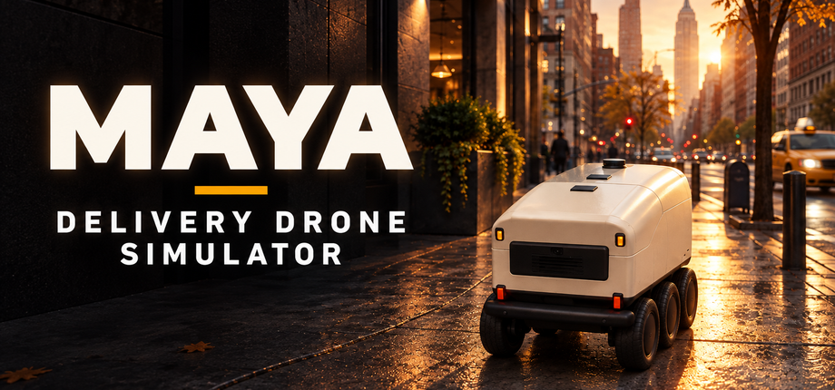
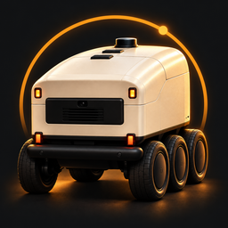
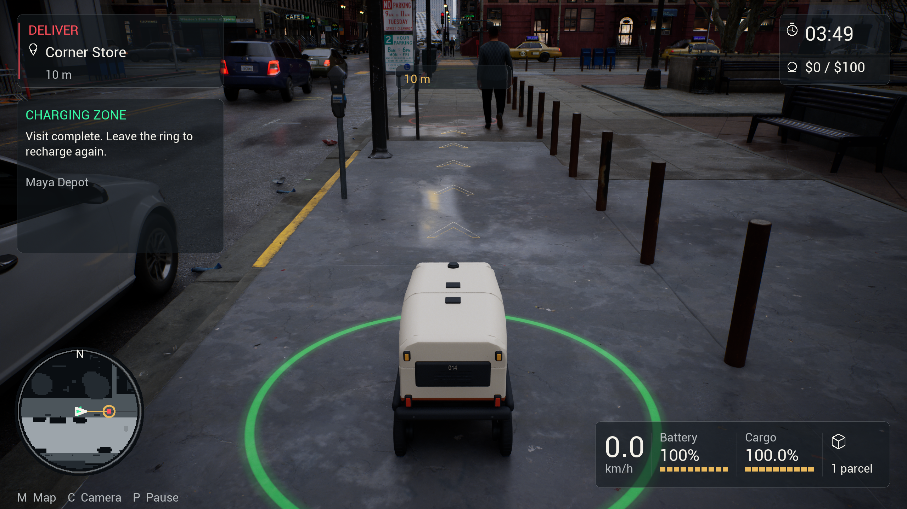
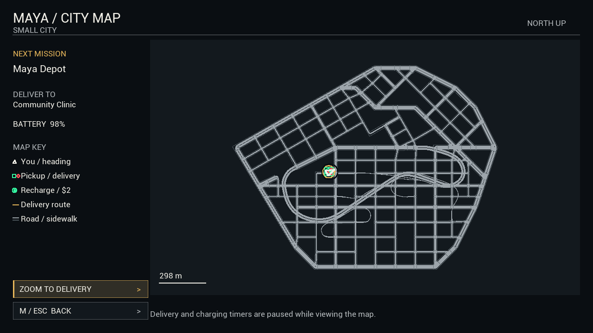

# Maya - Delivery Drone Simulator

**A city delivery shift, seen from six wheels.** Drive Maya through streets and sidewalks, collect parcels, manage battery and cargo condition, and work toward a $100 shift.

**Current scope: Windows v0.1 · Unreal Engine 5.3.2 · single-player · four delivery offers.** Maya is a ground delivery robot; the title does not imply aerial flight. The existing binary retains the earlier Maya Robotics / DDSCity names.

## The game

- Select one- or two-parcel jobs with delivery promises and payouts.
- Drive, reverse, brake and use Boost for extra road speed and low-speed wheel power.
- Stop for compartment loading/unloading and protect parcel condition.
- Plan your battery use, find charging rings and pay for recharging.
- Follow route cues, inspect the whole-city map and switch between chase and front POV cameras.

A one-parcel job pays $10 and a two-parcel job pays $16. Reach at least $100 net cash to win a shift. Traffic, deadlines, charging costs and cargo condition affect the outcome. Current shift progress is not saved; display/audio/accessibility settings persist. [Controls and complete rules](Documentation/HOW-TO-PLAY.md)

## Real gameplay

The following are unmodified v0.1 gameplay captures, separate from the AI-generated promotional cover above.

[Browse all captures and their version labels](Screenshots/README.md). Five 2560x1440 historical v0.1 screenshots are prepared as Steam candidates. Review them against the final submitted build; the release11 reference images are below Steam's screenshot resolution.

## What this repository contains

| Path | Contents |
|---|---|
| `Source/DDSCity/` | Custom delivery simulation, vehicle/cargo physics, HUD, navigation, menus and tests |
| `Source/CitySampleEditor/MAYA*` | Custom editor test bridge and startup observer; overlay into your authorized sample |
| `Plugins/DDSN05RobotProbe/` | Project-authored geometry probe plugin source |
| `Config/`, targets and `DDSCity.uproject` | Development project configuration and technical identifiers |
| `Artwork/` | Store/library exports, game icons, editable title SVGs and preserved art masters |
| `Documentation/` | Store descriptions, Steam checklist, AI survey draft, trailer plan, controls and source build guide |
| `Provenance/` | Artwork prompts, dimensions, screenshot hashes and runtime packaging facts |

The **211-file custom source snapshot** is byte-identical to the development workspace. Epic City Sample, Unreal Engine source/binaries and licensed robot/Content packages are separately acquired dependencies and are excluded. A checkout alone is **not a runnable complete Unreal project**. [Build guide](Documentation/SOURCE-BUILD-GUIDE.md) · [Source snapshot hashes](source-snapshot-manifest.json)

## Downloads and publishing

[Download Windows v0.1 and the source/Steam publishing packages](https://github.com/junainfinity/Maya-Delivery-Drone-Simulator/releases/tag/v0.1). The playable game uses **seven download parts**. [Download, verify and play](Documentation/WINDOWS-DOWNLOAD.md).

The full Windows game is `Maya-Delivery-Drone-Simulator-v0.1-Windows.zip`: 13,862,928,084 bytes, SHA-256 `7d11f5cb0309a389e1349db0790c1f0fb9bd79b509ad56f6396e6f53cc53636d`. Its seven release assets reconstruct the unchanged accepted release11 archive; large game files remain outside Git history. The supplied PowerShell helper checks each part and the complete ZIP. This packaging work did not rebuild or relaunch the game. The game binary's branding/icon will need a separate reviewed build update to adopt the new title/icon.

The artwork and publishing documents are prepared for Steam, with open account metadata and checks explicitly listed. A trailer remains to be recorded; system requirements need measurement; Steam installation, review and approval remain outstanding. [Steam submission checklist](Documentation/STEAM-SUBMISSION-CHECKLIST.md)

## Artwork and documentation

[Store copy](Documentation/STORE-COPY.md) · [Steam About BBCode](Documentation/STORE-ABOUT.bbcode.txt) · [Artwork dimensions](Documentation/ARTWORK-REQUIREMENTS.md) · [Prepared package](Documentation/PACKAGE-CONTENTS.md)

The cover art uses a charcoal, ivory and amber palette. Five scene/icon masters were generated with OpenAI's built-in image generation, with one hero refinement; title vectors were authored separately. Generated art is promotional illustration and does not replace real screenshots. [AI disclosure draft](Documentation/CONTENT-SURVEY-AI-DRAFT.md) · [Prompts and creation notes](Provenance/artwork-prompts.json)

## Rights and contributions

This is a public **source-available** repository. No open-source license grant has been selected; public visibility does not grant redistribution rights to the code or separately licensed assets. Do not upload engine/sample/publisher assets, credentials, generated build caches or private reports. [Rights and dependency inventory](Documentation/RIGHTS-AND-DEPENDENCIES.md)

For a bug report, include the game version, steps to reproduce and a screenshot or relevant sanitized log. For code changes, document behavior, dependency effects and tests; do not advertise planned features as available.
